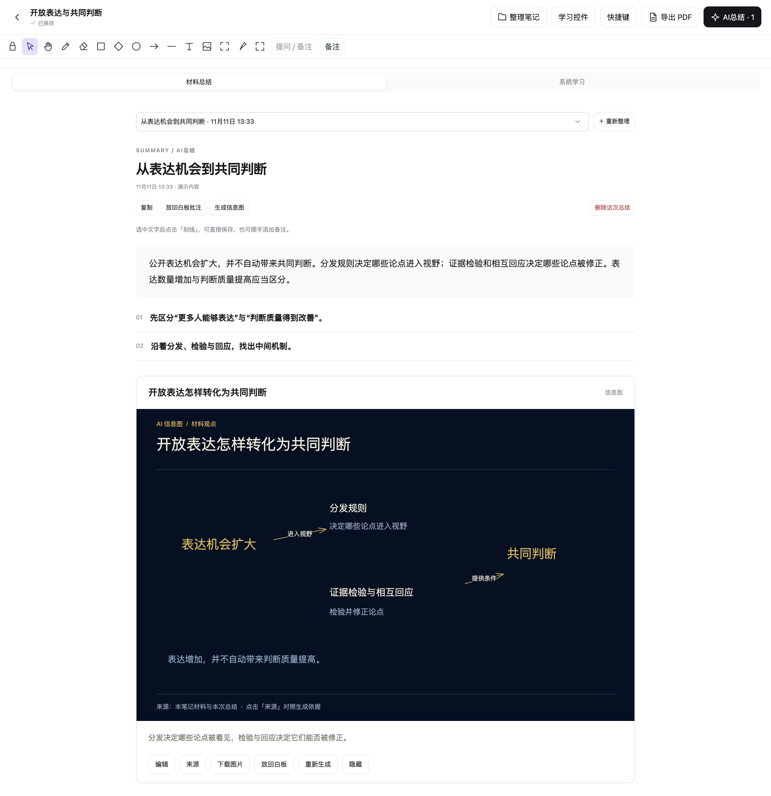
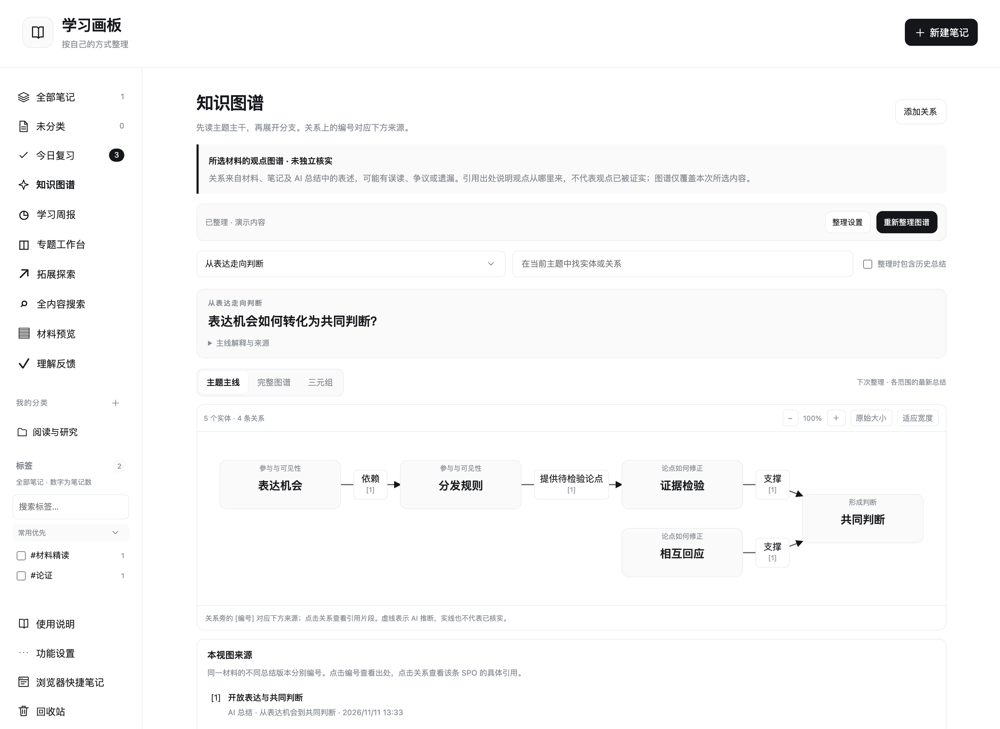
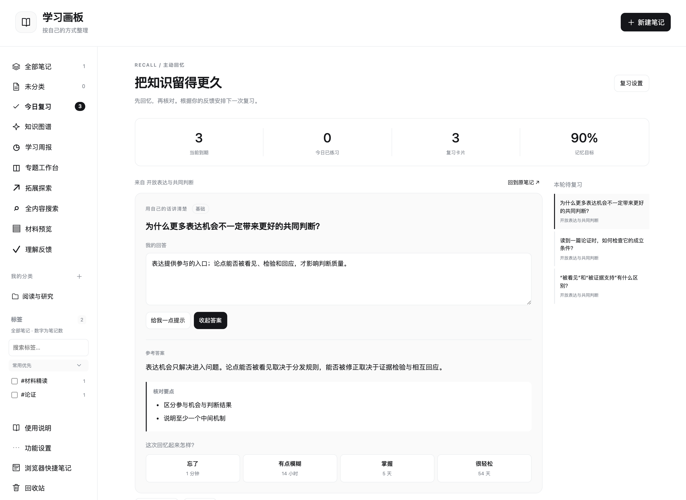
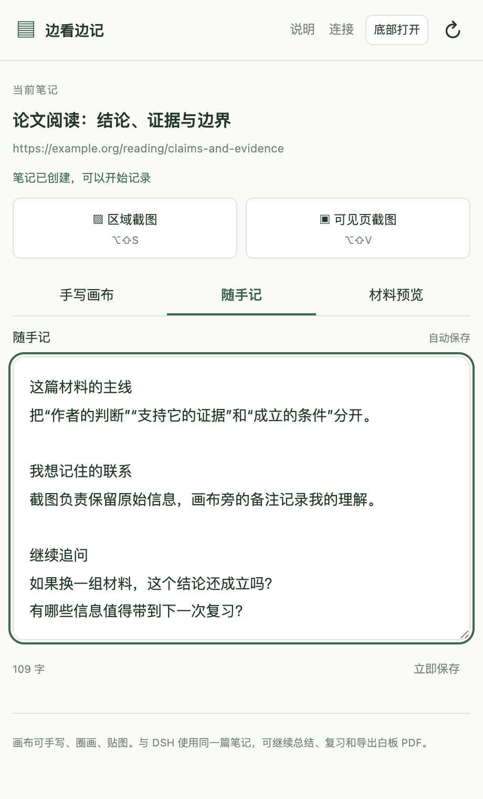
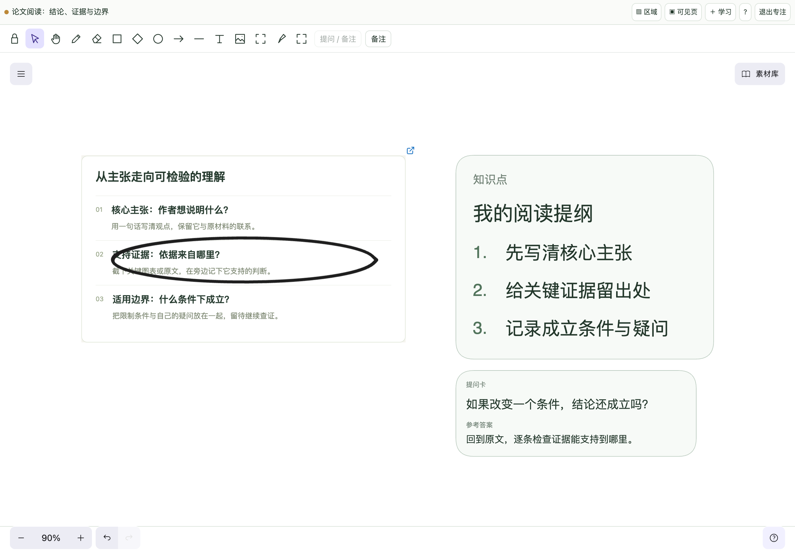
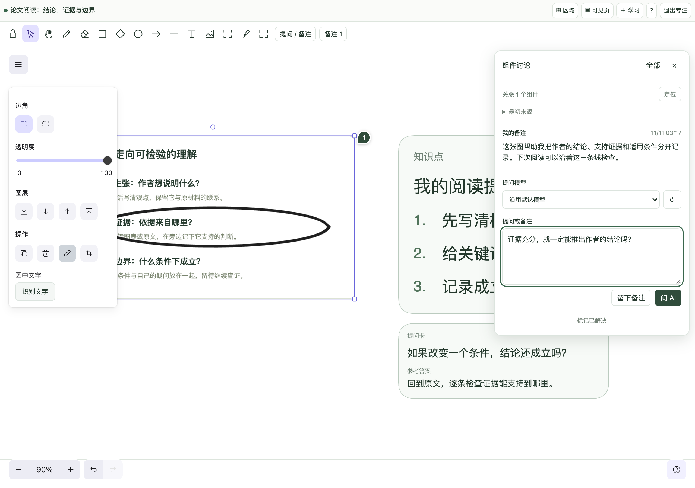
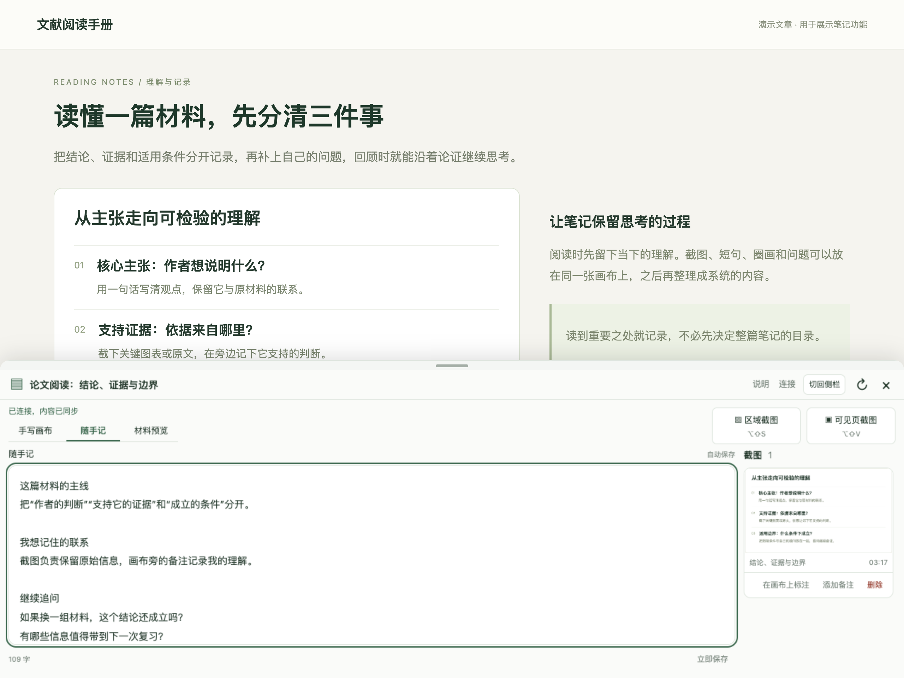

# 学习画板 · Quirky Stuff

在 DeepSeek Harness 中手写、贴图、整理材料和复习。配套 Chrome 扩展支持边阅读边记笔记、区域截图和网页来源定位。

Studyboard is a local learning workspace for DeepSeek Harness: handwritten notes, screenshots, structured AI summaries, editable infographics, source-linked knowledge graphs and spaced review.

- **自由白板**：触控笔、图片、形状、箭头、文字、自动保存、PDF 导出。
- **结构化记录**：提问卡、编号知识点、对比卡、步骤卡、图片备注；选定区域后自动排版，双击卡片编辑。
- **组件提问与备注**：选中文字、图片或一组组件向模型提问，继续追问或留下自己的备注。讨论标记跟随组件，支持已解决、重新打开和来源变化提示。
- **AI 总结**：按主题组织图文内容，保留原图，支持批注、拓展、互动自测和可选的间隔复习。
- **自适应信息图**：总结时按内容决定是否配图、复用原图或重新组织。生成的文字、图片与关系可编辑，支持来源对照、独立重做、历史版本和图片 / PDF / 可编辑画布导出。
- **系统学习**：在 AI 总结中选择系统学习，按主题决定机制图、论证关系、比较图或时间线；连接相关笔记、按需联网补充资料，生成可编辑论证白板。时间旅行研究区分当时的知识、解释边界与后来的修正。
- **学习周报**：选择周次总结知识主线，逐题回忆、核对答案并记录复习表现；结合具体作答与白板修订回顾进展，保留历史版本并可下载。
- **知识图谱**：用 SPO 表达材料观点，按主干和分支阅读，关系带来源编号、总结版本和引用片段。图谱未独立核实，可能有偏差或遗漏。
- **学习模块**：专题工作台、拓展探索、全内容搜索、材料预览、理解反馈，各项可独立开关。
- **浏览器配套**：侧栏与底部笔记、每个标签页独立绑定笔记、截图与草稿同步。

包名：`dsh-learning-quirky-stuff`。作者：Qiangsheng Liu。项目源码使用 [MIT](LICENSE)；第三方依赖与字体保留各自许可，详见构建后的 `THIRD_PARTY_NOTICES.md`。

## 安装

当前版本 **4.4.2** 适配 DSH **0.2.2-rc.1**。macOS 13+ 为完整功能的首批验证平台；发布包附带 Apple Silicon / Intel 本机识别程序。Linux、Windows 的通用功能可运行，但尚未完成完整平台验收，图片识别与本机 PDF 提取会明确提示不支持。

4.4.2 修复组件提问、自动换行、回答 Markdown 和重试状态，并支持删除备注草稿。


桌面版通过 DSH「插件」页面添加 npm 包 `dsh-learning-quirky-stuff@4.4.2`。离线安装可从 [Releases](https://github.com/EndWithHyphen/dsh-learning-quirky-stuff/releases) 下载 `.tgz`，解压后选择 `package` 目录。`desktop` profile 由 Electron 应用管理，CLI 不允许直接修改。

命令行版使用独立 profile 安装：

```sh
dsh plugin --profile studyboard add dsh-learning-quirky-stuff@4.4.2
```

在 DSH 中启用「自定义插件市场」，打开「插件 → 发现 → 添加索引源」，可使用本项目的发布索引：

```text
https://raw.githubusercontent.com/EndWithHyphen/dsh-learning-quirky-stuff/main/market/index.json
```

该索引仅在 npm 版本公开后生成，并核对安装包校验值。[npm 包](https://www.npmjs.com/package/dsh-learning-quirky-stuff) · [发布版本](https://github.com/EndWithHyphen/dsh-learning-quirky-stuff/releases/latest)

Chrome 配套为 [Release 中的独立 ZIP](https://github.com/EndWithHyphen/dsh-learning-quirky-stuff/releases/latest)。解压后在 `chrome://extensions` 开启开发者模式，选择「加载已解压的扩展程序」。首次打开扩展设置，点「连接本机 DSH」，再到 DSH 的「浏览器快捷笔记」允许连接。以后自动连接，无需输入连接码。旧版已建立的本机连接可迁移。

详细步骤：[安装与迁移](docs/install.md) · [使用说明](docs/user-guide.html) · [数据处理说明](docs/privacy.md)

## 在 DSH 中整理与复习

**AI 图文总结**：在笔记中点「AI总结」，选择模型生成。内容围绕主题组织，按需配上可编辑信息图；可以划线、追加备注、拓展主题，也可以进入「系统学习」继续研究。



**知识图谱与来源**：从左侧进入「知识图谱」，选择模型整理笔记中的实体和关系。按主干与分支阅读，点击关系查看「SPO来源」，回到原笔记核对。图谱保留材料观点的归属与依据。



**主动回忆与间隔复习**：在总结的自测区加入复习，再从「今日复习」进入。先写下自己的回答，再揭晓答案、核对要点，根据本次表现安排下一次复习；不需要的卡片可设为「不再出现」。



上面三张截图使用同一份合成演示材料，展示实际插件界面，不包含个人笔记。分类、标签和各项学习模块可按自己的习惯配置；系统学习、专题工作台与周报的完整操作见[使用说明](docs/user-guide.html)。

## Chrome 扩展：边看边记

连接后，在文章或视频页按 **⌘⇧Y**（Windows / Linux：**Ctrl⇧Y**）打开笔记侧栏。每个标签页各自绑定一篇笔记，自动保存网页链接；切换标签页可继续记录对应内容。

**侧栏随手记**适合快速留下主线、联系和疑问，写入内容后自动同步到本机 DSH。



**截图与画布**：点「区域截图」拖选关键部分，截图会放到当前笔记。切换「手写画布」即可圈画、添加图注、放置知识点或提问卡；「专注画布」让画布占满插件面板。



**选中组件后讨论**：点「提问 / 备注」，选模型并点「问 AI」，或点「留下备注」保存自己的想法。点击组件旁的编号再次展开；「备注」列表可查找讨论和已解决记录。DSH 主画布、系统学习白板与信息图编辑器也支持这一入口。



**底部打开**：侧栏顶部点「底部打开」，笔记面板会从当前网页下方展开，适合保留较宽的文章或视频区域。拖动面板上沿调整高度，也可切回侧栏。



| 操作 | macOS | Windows / Linux |
| --- | --- | --- |
| 打开当前标签页笔记 | ⌘⇧Y | Ctrl⇧Y |
| 区域截图 | ⌥⇧S | Alt⇧S |
| 可见页截图 | ⌥⇧V | Alt⇧V |
| 专注画布 | ⌥⇧F | Alt⇧F |
| 取消区域截图 | Esc | Esc |

截图和专注快捷键需要先让插件面板获得焦点；打开笔记的快捷键可在 `chrome://extensions/shortcuts` 修改。以上截图使用独立的演示文章和笔记。

## 模型与本机能力

DSH 中配置的模型负责 AI 功能，按所选账户的额度或计费规则使用。也可使用已安装并登录的本机 Codex CLI；模型列表显示实际模型和推理强度。普通总结关闭工具执行和联网；用户选择「联网寻找资料」时才开启搜索。

图片识别使用 macOS Vision，在本机运行；确认前可修改识别结果。正式包无需安装 Swift 编译工具。源码开发者运行 `npm run build:native` 构建识别程序。功能设置页展示本机能力状态。

## 开发与发布包

需要 Node.js 24+ 和 npm。发布前会构建客户端、检查依赖许可和产物，不使用个人笔记作为测试数据。

```sh
npm ci --legacy-peer-deps
npm run build:native # macOS；生成 arm64 / x64 识别程序
npm run build
npm test
npm run test:browser
npm run test:infographics-browser
npm run test:install
npm run release:local
```

产物位于 `dist/releases/`：DSH npm tarball、Chrome ZIP、SHA-256 校验文件与版本说明。包名、桥接协议与版本统一校验，构建时同步客户端注册信息。

发布流程、索引生成及 Git 安装方式见 [发布说明](docs/releasing.md)。源码参与方式见 [CONTRIBUTING.md](CONTRIBUTING.md)，模块边界见 [ARCHITECTURE.md](ARCHITECTURE.md)。

公开验证步骤见 [验证说明](docs/validation.md)，依赖升级、客户端影响与宿主 SDK 的剩余风险见 [依赖安全评估](docs/dependency-security.md)。

## 数据与配置

笔记默认保存在 DSH 用户目录的 `storages/studyboard-v1/`；升级包名时保留此目录。可用 `dataDir` 指定独立的绝对路径。同一数据目录只允许一个插件实例写入。卸载插件保留笔记；应用内永久删除和用户主动删除目录才会移除相应内容。

插件配置由 DSH 的组合包配置层提供，示例见 `docs/install.md`。浏览器服务仅监听本机回环地址，默认端口 43127；端口占用不会阻止白板功能。浏览器令牌保存在运行数据和浏览器存储中，不写入扩展安装目录，也不包含在发布包中。

请定期使用应用内「下载备份」。目前完整备份的恢复是受控的文件恢复流程，尚未提供一键恢复界面；步骤见安装与迁移文档。
